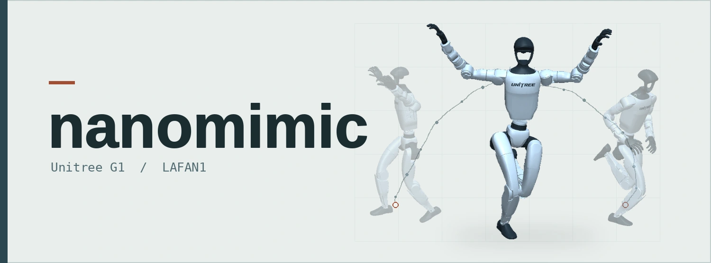
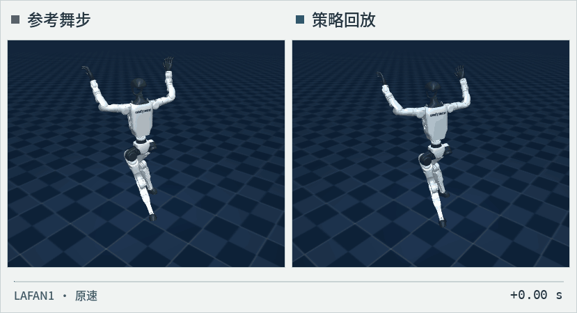
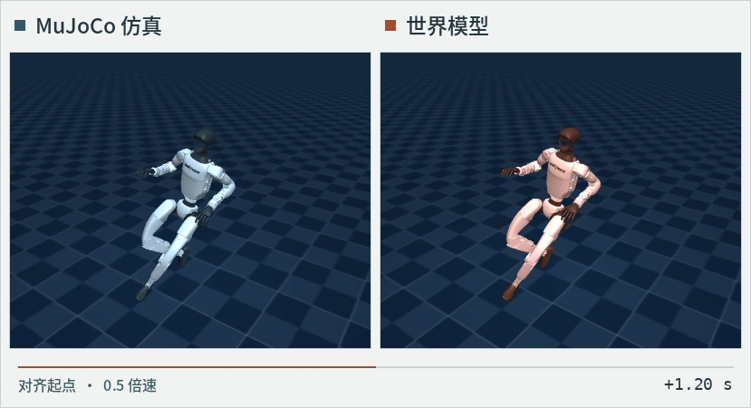
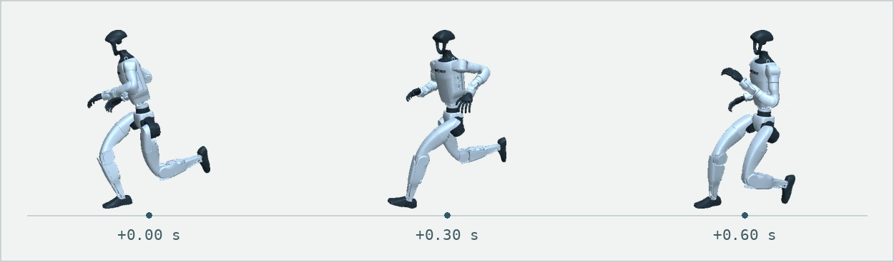

<h1 align="center">
  
</h1>

<p align="center"><strong>用可微世界模型训练 Unitree G1 跟踪全身动作</strong></p>

<p align="center">
  同一个策略跟随跑步和舞步，每秒为 29 个关节计算 50 次动作。
</p>

<p align="center">
  <a href="https://github.com/JasonG98/nanomimic/releases/tag/v0.1.0"><strong>下载预训练权重</strong></a> ·
  <a href="docs/QUICKSTART.md#使用预训练权重">快速开始</a> ·
  <a href="#舞步回放">舞步回放</a> ·
  <a href="https://jasong98.github.io/nanomimic/">交互图解</a>
</p>

nanomimic 独立复现了 SuperMimic 的 GenCoord 训练方法。G1 在 MuJoCo 里采集经验，世界模型学习动作怎样改变身体状态，策略沿着模型预测的轨迹反向传播。整套训练管线可在一张 RTX 5060 Ti 16 GB 上运行。[SuperMimic 源码](https://github.com/HybridRobotics/supermimic) · [论文](https://arxiv.org/abs/2610.28480)

## 舞步回放

左边是 LAFAN1 的参考舞步，右边是策略在 MuJoCo 里跑出来的。右边每 20 毫秒读一次传感器观测和参考目标，给 29 个关节出指令。落脚和转身都是仿真一步步算出来的。



这段舞步是 40 段训练动作之一。右边用的就是 v0.1.0 发布的 10 万轮检查点。封面也从这次回放里截取，细线是基座在地面平面上的轨迹。[演示记录](docs/NOTES.md#readme-回放与评估)

## 试用预训练策略

| 你想做什么 | 下载 |
| --- | --- |
| 在 CPU 上试跑一段动作 | [Actor ONNX · 27.2 MiB](https://github.com/JasonG98/nanomimic/releases/download/v0.1.0/nanomimic-g1-100k.onnx) |
| 看策略和世界模型并排回放，或接着训练 | [完整检查点 · 121.6 MiB](https://github.com/JasonG98/nanomimic/releases/download/v0.1.0/nanomimic-g1-100k.tar.gz) |

首次试跑只需 ONNX 和一段参考动作。下面的命令会在 CPU 仿真中跑完整段舞步，并打印完成率和跟踪误差。在仓库根目录运行。[安装与校验](docs/QUICKSTART.md#使用预训练权重)

```bash
uv sync --locked
mkdir -p runs/pretrained
curl -fL https://github.com/JasonG98/nanomimic/releases/download/v0.1.0/nanomimic-g1-100k.onnx \
  -o runs/pretrained/nanomimic-g1-100k.onnx
uv run python tools/make_motion.py dance1_subject1 --device cpu
uv run python tools/evaluate_tracking.py --onnx runs/pretrained/nanomimic-g1-100k.onnx \
  --motion-file data/processed/lafan1-g1-v1/clips/dance1_subject1.npz --device cpu --num-envs 1 --seed 0
```

## 怎么训练

1. **先在仿真里采集。** 策略控制 G1，训练程序记录动作以及仿真器返回的下一步状态。
2. **用数据拟合世界模型。** 给定当前状态和动作，模型预测基座和关节的速度变化，再积分得到下一步姿态。
3. **沿想象轨迹更新策略。** 从已采集的状态出发，让策略和世界模型一起向前滚动。跟踪奖励沿这段可微轨迹反传给策略。策略更新后，再回到仿真采集新数据。

下面两边从同一帧开始跑。左边是 MuJoCo，右边是世界模型。右边连着推了 120 步，每步都用自己预测出来的观测出下一次动作。转弯后，两边的轨迹会错开一点。点图看半速回放。

[](docs/media/world-model.gif)

[图解 Wiki](docs/wiki/README.md) · [训练与模型规格](docs/SPEC.md#4-模块规格)

## 实测结果

**本次发布的 10 万轮多动作策略**在 CPU 仿真中用同一份 ONNX 分别跟踪两段训练库内的动作。每段从第 0 帧开始，种子为 0，尝试一次。连杆位置误差在对齐基座平面位置和偏航后计算。

| 动作 | 完整跟踪 | 时长 | 连杆平均位置误差 |
| --- | ---: | ---: | ---: |
| 舞步 `dance1_subject1` | 1 / 1 | 131.46 秒 | 2.83 cm |
| 跑步 `run1_subject5` | 1 / 1 | 237.78 秒 | 2.83 cm |

动作与模型的哈希、逐次结果、误差口径均可下载。[评估记录](https://github.com/JasonG98/nanomimic/releases/download/v0.1.0/evaluation.json)

**另外训练的单段跑步策略**使用第 24 万轮检查点。训练和评估使用同一份 `run1_subject5` 数据，每次从第 0 帧开始，跟到 237.78 秒的末帧才算成功。

| 单段跑步评估 | 结果 |
| --- | ---: |
| 完整跟踪 | **64 / 64 次** |
| 连杆平均位置误差（重锚定） | 2.48 cm |
| 基座平均位置误差（世界系） | 1.11 m |

连杆误差是在对齐基座平面位置和偏航后算的。基座误差直接用世界坐标算。



训练在一张 RTX 5060 Ti 16 GB 上跑过。纯 Actor ONNX 通过了 CPU 数值自检，并在 CPU 仿真中跟完外置跑步动作。与 SuperMimic 的同条件对比、RTX 5060 Ti 上的 ONNX 仿真验证和真机测试待完成。[导出与闭环记录](docs/NOTES.md#纯-actor-与外置动作) · [GPU 实测](docs/NOTES_ARCHIVE.md#当前状态与待办)

## 交给你的 Agent

想试跑的话，把下面三行复制给 Agent 就行。

```text
按 docs/QUICKSTART.md 装一下这个仓库。
先跑 CPU 快速验证，再检查 CUDA 能不能用。
告诉我检查点路径和训练一段动作的命令。
```

[安装、训练、续训、回放与导出](docs/QUICKSTART.md) · [开发规格](docs/SPEC.md)

## 许可与致谢

项目代码采用 Apache-2.0。感谢 SuperMimic 作者公开训练方法和参考实现。[代码许可证](LICENSE) · [SuperMimic 项目主页](https://supermimic.github.io/)

训练参考来自 Ubisoft La Forge 的 LAFAN1 动作捕捉数据，经重定向用于 G1。原始动作采用 CC BY-NC-ND 4.0，复现命令从数据发布方获取所选片段。[原始数据与许可](https://github.com/ubisoft/ubisoft-laforge-animation-dataset) · [G1 重定向数据](https://huggingface.co/datasets/lvhaidong/LAFAN1_Retargeting_Dataset)
