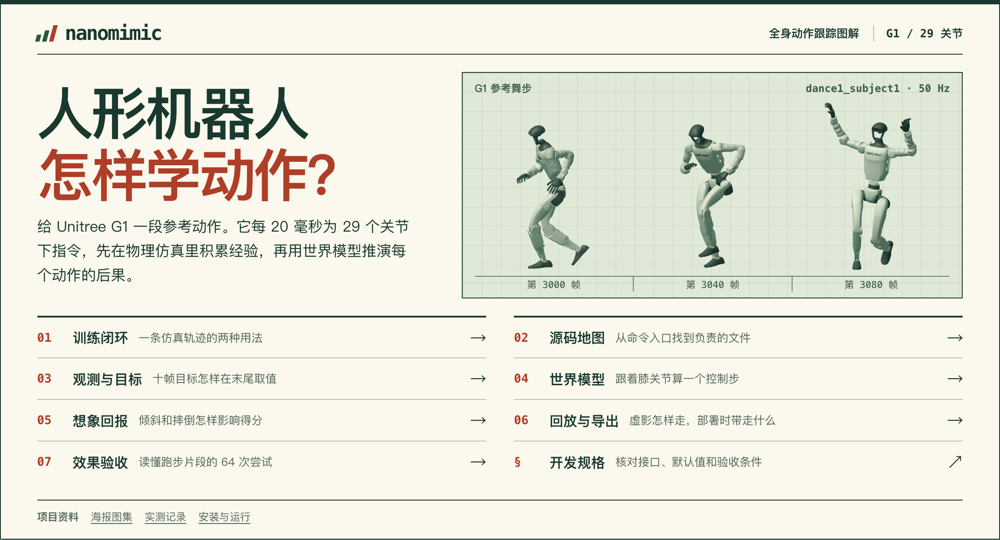

# nanomimic 图解 Wiki

第一次接触这个项目，可以先看训练闭环，再跟着一个膝关节算一遍世界模型。想修改代码时，从源码地图找对应的文件。[训练闭环](01-training.png) · [世界模型](04-world-model.png) · [源码地图](02-architecture.png)

| 海报 | 这张图回答的问题 |
| --- | --- |
| [01 · 训练闭环](01-training.png) | 一段仿真轨迹，怎样既能教世界模型预测，又能让策略练习后面的动作？ |
| [02 · 源码地图](02-architecture.png) | 从命令进入后，采集、想象、更新和仿真分别由哪个模块负责？ |
| [03 · 观测与目标](03-observations.png) | 如果当前只剩几帧，策略看到的十帧目标会是什么？ |
| [04 · 世界模型](04-world-model.png) | 网络输出速度增量之后，怎样算出膝关节的角度和脚的位置？ |
| [05 · 想象回报](05-return.png) | 当前姿势的误差，怎样改变下一步仍然站稳的权重？ |
| [06 · 回放与导出](06-runtime.png) | 预测虚影如何自己出动作，导出的 ONNX 又有哪些输入、输出？ |
| [07 · 效果验收](07-evaluation.png) | 在真实跑步片段上，怎样结合存活时间、位置误差和完整成功率判断进步？ |

上表的 PNG 可在 GitHub 直接浏览。把仓库保存在本地后，用浏览器打开 HTML 目录页即可离线翻页。观测页可拖动当前帧，回报页可调节误差，源码地图里的模块名可点击。浏览器打印将当前图解排为一张横向 A4。[HTML 目录页](html/index.html)

封面的姿势来自 `dance1_subject1` 转为 50 Hz 后的第 3000、3040、3080 帧，按帧号从 0 开始计数。图中将 mjlab 自带的 Unitree G1 模型放到记录的刚体位姿，三帧使用相同视角和比例。效果页使用另一个片段 `lafan_run1_subject5` 的训练评估记录。[动作转换工具](../../tools/make_motion.py) · [实测记录](../NOTES.md)
